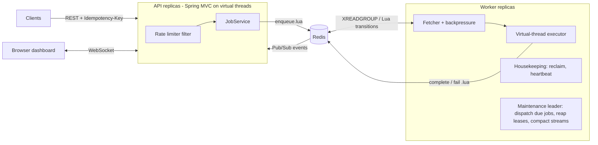
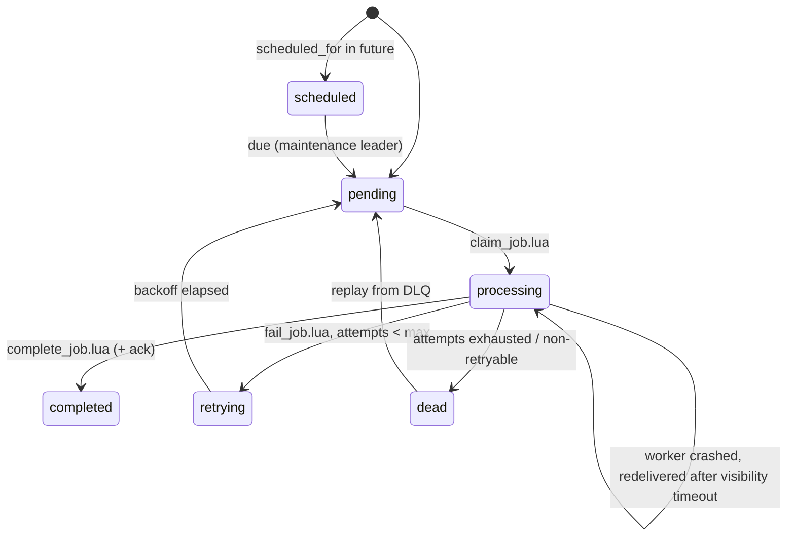

# RedisFlow (Java)

A distributed job queue and real-time processing platform built on Redis with **Java 21** and **Spring Boot 4**: reliable at-least-once delivery, crash recovery, retries with exponential backoff and jitter, dead-letter queues, priority lanes, delayed jobs, idempotent enqueue, distributed locks with fencing tokens, sliding-window rate limiting, a live WebSocket dashboard, and Prometheus metrics.

Think of it as a small Sidekiq/BullMQ/Celery, designed so that **every job state transition is one atomic Lua script**, so the system stays consistent when processes crash at any point.

> A Java/Spring redesign of my earlier Go prototype ([redisflow](https://github.com/singh-sudhir16/redisflow)). The port fixed several correctness gaps in the prototype; see [Design decisions](#design-decisions-and-trade-offs).

## Highlights

| | |
|---|---|
| **Throughput** | ~50k jobs/s enqueue, ~28k jobs/s processed by 2 workers ([benchmarks](#benchmarks)) |
| **Latency** | p99 enqueue-to-completion of 2–3 ms at a steady 10k jobs/s |
| **Durability** | 0 jobs lost when a worker is `kill -9`'d mid-batch (chaos test: 5,000 jobs, 1,000 orphaned deliveries) |
| **Tests** | 44 tests: unit + integration against real Redis (Testcontainers), including concurrency and chaos tests. 80% line coverage on the core engine |
| **Ops** | Docker Compose, graceful shutdown, health probes, Prometheus metrics, OpenAPI/Swagger UI, GitHub Actions CI |

## Architecture



**Redis data model** (all keys share a configurable prefix):

| Structure | Key | Purpose |
|---|---|---|
| Hash | `job:{id}` | Authoritative job state; streams and sets only carry the id |
| Stream + consumer group | `stream:{queue}` | FIFO queue with at-least-once delivery (PEL tracks unacked messages) |
| Sorted set ×2 + hash | `priority`, `priority:inflight`, `priority:leases` | Priority lane ordered by (priority, enqueue time), with SQS-style leases |
| Sorted set | `scheduled`, `retries` | Delayed jobs and retries waiting out their backoff (score = due time) |
| List | `dlq:{queue}` | Dead-letter queue |
| String + counter | `lock:{r}`, `lockfence:{r}` | Distributed locks and fencing tokens |
| Sorted set | `ratelimit:{client}` | Sliding-window log per client |
| Pub/Sub | `events` | Lifecycle events for the live dashboard |
| HyperLogLog / Bitmap / Geo | `analytics:*`, `activity:*`, `geo:workers` | Unique visitors, daily active users, worker locations |

### Job lifecycle



## Delivery guarantees

- **At-least-once.** A job is acknowledged only after its handler succeeds. If a worker dies first, the delivery stays in the stream's pending entries list, and another worker claims it once it has been idle longer than the visibility timeout (`XPENDING ... IDLE` + `XCLAIM`). The same applies to the priority lane through leases.
- **Handlers must be idempotent.** A job can run twice if a worker crashes after the side effect but before the ack. `Job.id()` is the natural idempotency key for downstream calls. The payment handler shows the pattern.
- **Idempotent enqueue.** `Idempotency-Key` makes producer retries safe: same key and body returns the original job (`200`, `Idempotent-Replayed: true`), and same key with a different body returns `422`.
- **Durability** is bounded by Redis persistence. Compose runs Redis with AOF `appendfsync everysec`, so a Redis crash can lose about 1 second of writes.

## Failure modes

| Failure | What happens |
|---|---|
| Worker `kill -9` mid-job | Unacked deliveries are reclaimed by a live worker after `visibility-timeout` (verified: 30 in-flight jobs recovered, 0 lost) |
| Worker crash-loops on a poison job | Every delivery increments `attempts`; once it exceeds `max_attempts` the job is dead-lettered instead of run again |
| Handler hangs | Interrupted at `job-timeout`, then retried. Startup requires `visibility-timeout > job-timeout`, so a live job is never handed to a second worker |
| `SIGTERM` / rolling deploy | Worker stops fetching and drains in-flight jobs (up to `shutdown-timeout`). Leftovers are redelivered |
| Maintenance leader dies | Its lease expires (15s) and another replica takes over. Leadership is an efficiency measure only: every duty is an atomic, idempotent claim, so overlap is safe |
| Redis loses consumer groups (FLUSHALL, failover without persistence) | Workers detect `NOGROUP` and recreate groups automatically |
| Redis unreachable | Fetchers back off exponentially (to 5s). The API returns `503` problem details, and the rate limiter fails open |
| Slow dashboard client | Its WebSocket buffer is capped and old messages are dropped; other clients are unaffected |

## Design decisions and trade-offs

1. **One Lua script per state transition.** Claim, complete, fail, retry, dead-letter, ack, counters and the lifecycle event happen together in one round trip. No crash window can leave a job acked but not marked complete, or marked dead but not in the DLQ. The scripts read time from Redis `TIME`, so API and worker hosts never disagree about "now" (no clock-skew bugs in scheduling).
2. **Streams over lists.** `BRPOP` deletes a message on delivery, so a crash loses it. Streams keep it in the PEL until `XACK`. The consumer group starts at id `0`, so jobs enqueued before any worker existed are still delivered.
3. **Safe stream compaction instead of `MAXLEN`.** Trimming at `XADD` with `MAXLEN` silently drops *undelivered* messages once the backlog exceeds the cap (a real bug in the prototype). Compaction instead computes the lowest of each group's last-delivered id and oldest pending id, then `XTRIM MINID`s below it, removing only acknowledged entries.
4. **Leased priority lane.** A plain `ZPOPMIN` loses the job if the worker dies. Claiming moves it to an in-flight set with a deadline; a reaper puts expired leases back with their original score, so the job keeps its place in line. Scores encode `priority × 10¹³ + enqueue_ms`, which gives FIFO within a priority level.
5. **Backpressure.** One fetcher per worker reads only as many jobs as there are free slots (a `Semaphore`), so a worker never hoards messages it can't start. Each job runs on its own virtual thread, with a hard timeout.
6. **Exponential backoff with equal jitter** (`d/2 + rand(d/2)`, capped). This spreads retries out, so a downstream outage doesn't trigger a synchronized retry storm.
7. **Request path never borrows a pooled connection.** Regular commands multiplex over one Lettuce connection. Load testing caught a filter that used a client-side pipeline: pipelines need a *dedicated* pooled connection, so under 64 concurrent clients every request thread queued on the pool (default wait: forever) and the server stalled. A thread dump showed request threads parked in `borrowObject`/connection creation, which was probably made worse by virtual-thread pinning on Java 21. The fix was a single Lua script, plus a pool `max-wait` so exhaustion fails fast instead of hanging.
8. **Locks with fencing tokens.** `SET NX PX` plus compare-and-delete/renew scripts, and a monotonically increasing token per resource. A paused holder whose lease expired can be rejected downstream. This is a single-primary lease, not Redlock/consensus, which is documented as such.
9. **Sliding-window log rate limiting.** Exact and atomic across API replicas, at O(limit) memory per client. A sliding-window counter or GCRA would be the O(1) alternative at higher limits.

### Known limits and next steps

- Assumes a single Redis primary (or Sentinel). For Redis Cluster, keys would need hash tags such as `{queue}` so that multi-key scripts stay in one slot.
- The priority lane is strict, so a flood of critical jobs can starve normal queues. Weighted fair scheduling would fix that.
- Next: OpenTelemetry trace propagation from producer to handler, per-tenant quotas, cron-style recurring jobs, and an outbox for exactly-once side effects.

## Benchmarks

Measured with the `redisflow-bench` module on an Apple M1 (8 cores, 8 GB), with Redis 8.10 and JDK 21 on the same machine. Every run uses an isolated key prefix and cleans up after itself. Numbers are from repeated runs; reproduce with `make bench`.

| Scenario | Result |
|---|---|
| Enqueue, 64 concurrent producers (100k jobs) | **50–51k jobs/s**, p50 1.1 ms, p99 4.4 ms |
| Drain a 100k-job backlog, 2 workers × 64 slots, no-op handler | **28–29k jobs/s** |
| Enqueue → completion latency at a steady 10k jobs/s (150k samples) | p50 1 ms, p95 1 ms, **p99 2–3 ms** |
| Enqueue → completion latency at a steady 2k jobs/s (40k samples) | p99 ≤ 1 ms |
| HTTP `POST /api/v1/jobs`, 32 clients, warmed up | **8.7k req/s**, p50 3.0 ms, p99 13 ms |
| HTTP `POST /api/v1/jobs`, 64 clients, warmed up | 6.8k req/s, p50 7.4 ms, p99 44 ms |

Latency is measured on the Redis clock at 1 ms resolution. The load generator, API and Redis shared one laptop, so these are relative numbers, not capacity planning.

## Running it

**Docker (everything):**

```bash
docker compose up --build            # Redis + API + 2 workers
open http://localhost:8080/dashboard # live dashboard
open http://localhost:8080/swagger-ui.html
make demo                            # enqueue sample jobs
docker compose --profile observability up   # adds Prometheus on :9090
```

**Locally (JDK 21 and Redis):**

```bash
make run-redis       # terminal 1
make run-api         # terminal 2 (port 8080)
make run-worker      # terminal 3 (actuator on 8081); start more with PORT=8082 make run-worker
```

**Try the guarantees:**

```bash
# idempotent enqueue: run twice, the second returns the same job with Idempotent-Replayed: true
curl -i -X POST localhost:8080/api/v1/jobs -H 'Content-Type: application/json' -H 'Idempotency-Key: order-42' \
  -d '{"queue":"payments","type":"payment","payload":{"amount":10,"currency":"INR"}}'

# crash recovery: enqueue slow jobs, kill -9 a worker, watch another one reclaim them
for i in $(seq 20); do curl -s -X POST localhost:8080/api/v1/jobs -H 'Content-Type: application/json' \
  -d '{"type":"slow","payload":{"seconds":3}}' > /dev/null; done
```

## API

| Method | Path | Description |
|---|---|---|
| `POST` | `/api/v1/jobs` | Enqueue (`queue`, `type`, `payload`, `priority` 1-4, `max_attempts`, `scheduled_for`). Optional `Idempotency-Key` header |
| `GET` | `/api/v1/jobs/{id}` | Job state, attempts, timestamps, last error |
| `GET` | `/api/v1/stats` | All queues (backlog, pending, consumers, DLQ), priority lane, scheduled/retrying, totals |
| `GET` | `/api/v1/queues/{queue}/dlq` | Dead-lettered jobs |
| `POST` | `/api/v1/queues/{queue}/dlq/{id}/replay` | Re-enqueue a dead job with a fresh attempt budget |
| `GET/POST/DELETE` | `/api/v1/locks/{resource}` | Inspect / acquire (returns fencing token) / release |
| `GET` | `/api/v1/workers` | Live workers from heartbeats |
| `GET` | `/api/v1/analytics/visitors?from=&to=` | HyperLogLog unique visitors and IPs over a date range |
| `POST/GET` | `/api/v1/activity/{userId}`, `/api/v1/activity/count` | Bitmap daily active users |
| `POST/GET` | `/api/v1/geo/workers/{id}`, `/api/v1/geo/nearby` | Worker locations, radius search |
| `GET` | `/dashboard`, `/ws/events` | Live dashboard and its event stream |
| `GET` | `/actuator/health`, `/actuator/prometheus` | Probes and metrics |

Errors use RFC 9457 problem details (`application/problem+json`). Every `/api` response carries `X-RateLimit-Limit` and `X-RateLimit-Remaining`; a `429` also includes `Retry-After`.

## Configuration

Everything binds from `redisflow.*` (for example `REDISFLOW_WORKER_CONCURRENCY=64`) and the standard `spring.data.redis.*` settings.

| Property | Default | |
|---|---|---|
| `redisflow.worker.queues` | `default,emails,payments,notifications` | Queues a worker consumes |
| `redisflow.worker.concurrency` | 32 (worker app) | Job slots per worker |
| `redisflow.worker.visibility-timeout` | 60s | Unacked deliveries older than this are reclaimed |
| `redisflow.worker.job-timeout` | 30s | Handler hard timeout (must be < visibility timeout) |
| `redisflow.worker.shutdown-timeout` | 25s | Drain time on SIGTERM |
| `redisflow.jobs.default-max-attempts` | 3 | |
| `redisflow.retry.base-delay` / `max-delay` | 2s / 5m | Exponential backoff bounds |
| `redisflow.jobs.completed-retention` | 24h | Completed jobs expire; dead jobs are kept |
| `redisflow.rate-limit.limit` / `window` | 300 / 1m | Per client (`X-User-ID` or IP) |
| `redisflow.key-prefix` | `redisflow` | Isolates deployments sharing a Redis |

## Testing

```bash
./mvnw verify   # unit tests + integration tests against Redis 7.4 in Docker (Testcontainers) + JaCoCo report
```

Integration tests run against a real Redis, not mocks. They include:
- **Chaos.** A consumer grabs 1,000 deliveries and dies without acking; 2 survivors finish all 5,000 jobs with none lost. Crashed priority leases are re-queued.
- **Concurrency.** 64 threads race for one lock and exactly one wins; 300 concurrent requests against a limit of 100 and exactly 100 pass; 256 concurrent HTTP requests.
- **Semantics.** Retry-then-succeed, dead-lettering, non-retryable errors, DLQ replay, priority ordering, timeouts, scheduling, graceful shutdown, safe compaction, leader failover, idempotency, HyperLogLog accuracy, bitmaps, geo.
- **API.** 202/Location, snake_case JSON, problem details, 404, 422 on idempotency conflicts, 429 with `Retry-After`, actuator, and the WebSocket event stream.

On macOS with Colima, point Testcontainers at its socket:
`export DOCKER_HOST=unix://$HOME/.colima/default/docker.sock TESTCONTAINERS_DOCKER_SOCKET_OVERRIDE=/var/run/docker.sock`

## Project structure

```
redisflow-core     Engine library + Spring Boot auto-configuration
  ├─ job/          Job model, JobService (enqueue, idempotency, DLQ replay)
  ├─ queue/        StreamQueue, PriorityLane, DelayedJobDispatcher, QueueStatsService
  ├─ worker/       WorkerEngine, JobLifecycle, JobHandler SPI, heartbeats, metrics
  ├─ maintenance/  Leader-elected scheduler / lease reaper / stream compaction
  ├─ lock/         DistributedLockService (fencing tokens), LeaderElection
  ├─ ratelimit/    SlidingWindowRateLimiter
  ├─ analytics/    HyperLogLog visitors, bitmap activity, geo index
  └─ resources/redisflow/lua/   All atomic state transitions
redisflow-api      REST API, RFC 9457 errors, rate-limit filter, WebSocket relay, dashboard, OpenAPI
redisflow-worker   Worker app + handlers (email via SMTP, payment, notification, flaky, slow, noop)
redisflow-bench    Reproducible throughput / latency / HTTP benchmarks
```

Add a job type by registering a bean:

```java
@Component
class InvoiceHandler implements JobHandler {
    public String type() { return "invoice"; }
    public void handle(Job job) { /* idempotent work; throw NonRetryableJobException for bad input */ }
}
```
